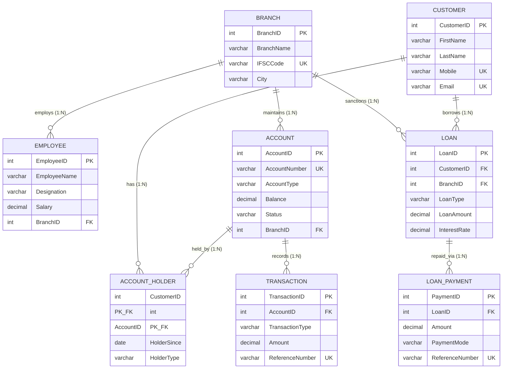

# PROJECT KASHI: Banking Management System
## Database Management System (DBMS) Laboratory Project Report
**Course:** Database Management Systems (B.Tech CSE - 3rd Semester)  
**Submission Date:** 28th October, 2026  
**Maximum Marks:** 10 (Class Internal Assessment)  
**Technology Stack:** 3-Tier Architecture (Raw HTML5/CSS Frontend, Python Flask Backend, MySQL 8.0 Database)

---

## 1. Executive Project Overview
**Project Kashi** is a database-driven Banking Management System designed to simulate core enterprise banking operations. The goal is to apply theoretical Database Management System (DBMS) concepts in an operational software environment. 

The application follows a **strict 3-Tier Architecture**:
1. **Presentation Layer (Frontend):** Pure HTML5 semantic markup with custom modern Vanilla CSS styling (forms, tables, modal dialogs, passbooks). No complex frontend frameworks (such as React or Vue) are used, ensuring a direct understanding of standard browser-to-server request cycles.
2. **Application Layer (Backend):** Python with Flask framework handling HTTP routing, session management, input validation, and business logic coordination.
3. **Data Layer (Database):** MySQL 8.0 relational database engine implementing relational schemas, declarative constraints, views, stored procedures, user-defined functions, triggers, and ACID transactions.

---

## 2. Entity-Relationship (ER) Modeling

### 2.1 Identified Entities & Attributes
The system identifies **8 core entities** modeling an enterprise banking domain:

| Entity | Primary Key | Key Attributes | Description |
| :--- | :--- | :--- | :--- |
| **`BRANCH`** | `BranchID` | `BranchName`, `IFSCCode`, `Address`, `City`, `State`, `ContactNumber` | Physical branch offices where accounts and employees belong. |
| **`CUSTOMER`** | `CustomerID` | `FirstName`, `LastName`, `DateOfBirth`, `Gender`, `Mobile`, `Email`, `Address`, `City`, `RegistrationDate` | Bank clients with unique KYC details (Mobile and Email). |
| **`EMPLOYEE`** | `EmployeeID` | `EmployeeName`, `Mobile`, `Email`, `Designation`, `Salary`, `JoiningDate`, `BranchID` | Bank staff operating within a branch. |
| **`ACCOUNT`** | `AccountID` | `AccountNumber`, `AccountType`, `OpeningDate`, `Balance`, `Status`, `BranchID` | Financial accounts (Saving, Current, Salary) holding liquidity. |
| **`ACCOUNT_HOLDER`** | `(CustomerID, AccountID)` | `HolderSince`, `HolderType` | Associative bridge entity modeling Many-to-Many customer-account relations. |
| **`TRANSACTION`** | `TransactionID` | `AccountID`, `TransactionType`, `Amount`, `TransactionDate`, `Description`, `ReferenceNumber`, `TransactionStatus` | Tamper-evident ledger of financial debits and credits. |
| **`LOAN`** | `LoanID` | `CustomerID`, `BranchID`, `LoanType`, `LoanAmount`, `InterestRate`, `StartDate`, `TenureMonths`, `LoanStatus` | Lending contracts sanctioned to customers. |
| **`LOAN_PAYMENT`** | `PaymentID` | `LoanID`, `PaymentDate`, `Amount`, `PaymentMode`, `ReferenceNumber` | Repayment installments credited against sanctioned loans. |

---

### 2.2 Relationships & Cardinality

| Relationship | Participating Entities | Cardinality | Ratio | Business Rule |
| :--- | :--- | :--- | :--- | :--- |
| **Employs** | `BRANCH` &rarr; `EMPLOYEE` | $1 : N$ (One-to-Many) | Mandatory ($1$) to Optional ($N$) | A branch employs multiple staff; an employee works at exactly one branch. |
| **Maintains** | `BRANCH` &rarr; `ACCOUNT` | $1 : N$ (One-to-Many) | Mandatory ($1$) to Optional ($N$) | An account is domiciled at one branch; a branch maintains many accounts. |
| **Sanctions** | `BRANCH` &rarr; `LOAN` | $1 : N$ (One-to-Many) | Mandatory ($1$) to Optional ($N$) | A loan is approved by a specific branch. |
| **Holds** | `CUSTOMER` &harr; `ACCOUNT` | $M : N$ (Many-to-Many) | Resolved via `ACCOUNT_HOLDER` | A customer can hold multiple accounts (e.g. Saving + Salary); joint accounts can have multiple owners. |
| **Records** | `ACCOUNT` &rarr; `TRANSACTION` | $1 : N$ (One-to-Many) | Mandatory ($1$) to Optional ($N$) | An account logs many transactions; every transaction belongs to one account. |
| **Borrows** | `CUSTOMER` &rarr; `LOAN` | $1 : N$ (One-to-Many) | Mandatory ($1$) to Optional ($N$) | A customer can borrow multiple loans; each loan is tied to a primary borrower. |
| **Repaid Via** | `LOAN` &rarr; `LOAN_PAYMENT` | $1 : N$ (One-to-Many) | Mandatory ($1$) to Optional ($N$) | A loan has many repayment installments over its tenure. |

---

### 2.3 Visual ER Diagram (Mermaid Notation)



---

## 3. Relational Schema Design & Constraints

The relational model enforces **Domain Integrity**, **Entity Integrity**, and **Referential Integrity**.

```
BRANCH(BranchID [PK], BranchName, IFSCCode [UNIQUE], Address, City, State, ContactNumber, CreatedAt)

CUSTOMER(CustomerID [PK], FirstName, LastName, DateOfBirth, Gender, Mobile [UNIQUE], Email [UNIQUE], Address, City, RegistrationDate)

EMPLOYEE(EmployeeID [PK], EmployeeName, Mobile, Email [UNIQUE], Designation, Salary [CHECK > 0], JoiningDate, BranchID [FK -> BRANCH.BranchID])

ACCOUNT(AccountID [PK], AccountNumber [UNIQUE], AccountType [ENUM], OpeningDate, Balance [CHECK >= 0], Status [ENUM], BranchID [FK -> BRANCH.BranchID])

ACCOUNT_HOLDER(CustomerID [PK, FK -> CUSTOMER.CustomerID ON DELETE CASCADE], AccountID [PK, FK -> ACCOUNT.AccountID ON DELETE CASCADE], HolderSince, HolderType)

TRANSACTION(TransactionID [PK], AccountID [FK -> ACCOUNT.AccountID], TransactionType [ENUM], Amount [CHECK > 0], TransactionDate, Description, ReferenceNumber [UNIQUE], TransactionStatus [ENUM])

LOAN(LoanID [PK], CustomerID [FK -> CUSTOMER.CustomerID], BranchID [FK -> BRANCH.BranchID], LoanType [ENUM], LoanAmount [CHECK > 0], InterestRate [CHECK >= 0], StartDate, TenureMonths [CHECK > 0], LoanStatus [ENUM], CreatedAt)

LOAN_PAYMENT(PaymentID [PK], LoanID [FK -> LOAN.LoanID], PaymentDate, Amount [CHECK > 0], PaymentMode, ReferenceNumber [UNIQUE])
```

### 3.1 Constraints Enforced
1. **Primary Key Constraints:** Guarantees uniqueness and non-null values for entity identifiers.
2. **Foreign Key Constraints:** Enforces referential consistency with `ON DELETE CASCADE` for junction entities (`ACCOUNT_HOLDER`) and `ON DELETE RESTRICT` for master entities to prevent orphaned records.
3. **Unique Constraints (`UNIQUE`):** Prevents duplicate entries on `IFSCCode`, `Mobile`, `Email`, `AccountNumber`, and transaction `ReferenceNumber`.
4. **Check Constraints (`CHECK`):**
   - `ACCOUNT.Balance >= 0.00`: Prohibits unauthorized negative balances at database engine level.
   - `TRANSACTION.Amount > 0.00`: Prevents zero or negative transaction entries.
   - `EMPLOYEE.Salary > 0.00`: Enforces positive salary compensation.
5. **Domain Constraints (`ENUM`):**
   - `AccountType`: `'Saving'`, `'Current'`, `'Salary'`
   - `Status`: `'Active'`, `'Inactive'`, `'Close'`
   - `TransactionType`: `'DEPOSIT'`, `'WITHDRAWAL'`, `'TRANSFER_IN'`, `'TRANSFER_OUT'`

---

## 4. Database Normalization (1NF to BCNF Proof)

### 4.1 First Normal Form (1NF)
- **Requirement:** Each attribute must contain only atomic (indivisible) values, and no repeating groups.
- **Compliance:** Customer names are split into `FirstName` and `LastName`. Multi-valued contacts are eliminated (each customer has an individual mobile and email string). Address attributes are separated into atomic `Address`, `City`, and `State`.

### 4.2 Second Normal Form (2NF)
- **Requirement:** Must be in 1NF, and all non-key attributes must be fully functionally dependent on the entire primary key (no partial dependencies).
- **Compliance:** In `ACCOUNT_HOLDER`, the composite primary key is `(CustomerID, AccountID)`. The non-key attributes `HolderSince` and `HolderType` depend on **both** the customer and account combination, not on `CustomerID` alone or `AccountID` alone. All single-attribute primary key tables are automatically free from partial dependencies.

### 4.3 Third Normal Form (3NF)
- **Requirement:** Must be in 2NF, and no transitive dependency exists (non-key attribute determining another non-key attribute: $X \to Y \to Z$).
- **Compliance:** In earlier naive designs, `Account` contained `BranchName`, `IFSCCode`, and `BranchCity`. Because `AccountID \to BranchID \to BranchName`, this represented a transitive dependency. By decomposing `BRANCH` into a separate relation, transitive dependencies are completely eliminated.

### 4.4 Boyce-Codd Normal Form (BCNF)
- **Requirement:** For every functional dependency $X \to Y$, $X$ must be a super key.
- **Compliance:** In all 8 tables, every determinant is either a candidate key or primary key. Hence, the database schema is in **BCNF**.

---

## 5. Advanced Database Objects

### 5.1 Views (Database Abstraction)
1. **`vw_customer_accounts`:** Combines `CUSTOMER`, `ACCOUNT_HOLDER`, `ACCOUNT`, and `BRANCH` to present a single virtual table of customer profiles and active balances.
2. **`vw_passbook`:** Denormalized audit view connecting `TRANSACTION`, `ACCOUNT`, `CUSTOMER`, and `BRANCH` for instant customer passbook rendering.
3. **`vw_branch_summary`:** Aggregates branch liquidity, accounts, employee count, and loan exposure.

### 5.2 Stored Procedures (Business Logic & Transactions)
1. **`sp_transfer_funds(p_sender, p_receiver, p_amount, p_desc, OUT status_code, OUT status_msg)`**
   - Demonstrates **ACID Transactions**:
     - `START TRANSACTION;`
     - Uses `SELECT ... FOR UPDATE` to acquire pessimistic row-level locks on sender and receiver account records.
     - Verifies account status (`Active`) and available balance (`Balance >= p_amount`).
     - Simultaneously debits sender and credits receiver.
     - Records paired ledger entries: `TRANSFER_OUT` and `TRANSFER_IN`.
     - Executes `COMMIT;` upon success or `ROLLBACK;` upon any constraint failure.
2. **`sp_deposit_money`**: Safely increments account balance and logs deposit transaction.
3. **`sp_withdraw_money`**: Validates sufficient balance, decrements balance, and records withdrawal.

### 5.3 User-Defined Stored Functions
1. **`fn_customer_total_balance(p_cust_id INT) RETURNS DECIMAL(15,2)`**
   - Returns the cumulative liquid wealth across all accounts held by a customer.
2. **`fn_calculate_emi(p_amount, p_annual_rate, p_tenure_months) RETURNS DECIMAL(10,2)`**
   - Implements the standard mathematical financial loan installment formula:
     $$\text{EMI} = \frac{P \cdot r \cdot (1 + r)^N}{(1 + r)^N - 1}$$
     where $P = \text{Principal}$, $r = \frac{\text{Annual Rate}}{12 \times 100}$, and $N = \text{Tenure in Months}$.

### 5.4 Triggers (Automated Event Handling)
1. **`trg_prevent_negative_balance` (BEFORE UPDATE ON ACCOUNT):**
   - Intercepts balance modifications and raises an SQL error (`SQLSTATE '45000'`) if balance falls below zero.
2. **`trg_check_loan_completion` (AFTER INSERT ON LOAN_PAYMENT):**
   - Automatically computes total repayments against the loan's principal amount and updates `LoanStatus = 'Closed'` when fully settled.

---

## 6. 10 Meaningful Business Problems & SQL Solutions

All 10 queries are implemented and executable through the interactive web application console:

1. **Problem 1 (Top 5 Wealthiest Customers):**
   ```sql
   SELECT c.CustomerID, CONCAT(c.FirstName, ' ', c.LastName) AS CustomerName,
          COUNT(a.AccountID) AS TotalAccountsOwned, SUM(a.Balance) AS TotalAggregateBalance
   FROM CUSTOMER c
   JOIN ACCOUNT_HOLDER ah ON c.CustomerID = ah.CustomerID
   JOIN ACCOUNT a ON ah.AccountID = a.AccountID
   WHERE a.Status = 'Active'
   GROUP BY c.CustomerID, c.FirstName, c.LastName
   ORDER BY TotalAggregateBalance DESC LIMIT 5;
   ```
2. **Problem 2 (Branch Liquidity vs Loan Exposure):** Evaluates asset-liability matching using multi-table derived subqueries and `CASE` expressions.
3. **Problem 3 (Dormant Account Detection):** Filters accounts with no transactions within the last 90 days using `LEFT JOIN` and `HAVING`.
4. **Problem 4 (Cross-Selling: Savings + Loan Holders):** Identifies high-engagement customers using `IN` subqueries.
5. **Problem 5 (Anti-Money Laundering High-Value Audit):** Tracks all transactions $\ge \text{₹}20,000$ with audit parameters.
6. **Problem 6 (Staff Productivity & Deposit Volume per Employee):** Calculates staff salaries and deposit volume managed per staff member using `NULLIF()`.
7. **Problem 7 (Loan Repayment & Outstanding Recovery):** Computes outstanding principal and repayment percentage using `COALESCE` and `LEFT JOIN`.
8. **Problem 8 (Multi-Account Customers):** Groups customers holding $>1$ account using `GROUP_CONCAT` and `HAVING COUNT() > 1`.
9. **Problem 9 (Cash Velocity Inflow vs Outflow):** Aggregates turnover and average transaction size by transaction type.
10. **Problem 10 (Geographic Penetration & Demographics):** Evaluates customer volume, average age using `TIMESTAMPDIFF(YEAR, DateOfBirth, CURDATE())`, and deposits per city.

---

## 7. Application Workflow & Screen Descriptions

### 7.1 System Architecture
```
[ Browser / Client ] 
        │  (HTTP GET / POST)
        ▼
[ Flask Application (Python 3.13) ]
   ├── Routing (app.py)
   ├── Template Engine (Jinja2 / Raw HTML)
   ├── Input Validation & Error Handling
   └── DB Connector (PyMySQL)
        │  (SQL / Stored Procedures / Transactions)
        ▼
[ MySQL 8.0 Relational Database Engine ]
   ├── Tables, Constraints, & Indexes
   ├── Stored Procedures (ACID Transactions)
   ├── Triggers & Functions
   └── Virtual Views
```

### 7.2 Core Pages
- **`/` (Executive Dashboard):** Live financial cards (Deposits, Loans, Customers, Branches), recent transactions passbook, and branch liquidity summary.
- **`/customers`:** Customer directory with search filter and "Register New Customer" modal dialog.
- **`/customers/<id>`:** Profile detailing personal data, total liquid wealth (`fn_customer_total_balance`), linked accounts, and loan repayment records.
- **`/accounts`:** Complete account portfolio with "Open New Account" workflow.
- **`/transactions`:** Banking Operations Hub with 3 dedicated operation tabs (Atomic Fund Transfer, Deposit, Withdrawal) and filtered transaction passbook.
- **`/loans`:** Loan portfolio with interactive client-side and server-side EMI calculator, loan disbursement modal, and loan payment modal.
- **`/branches`:** Branch and employee roster with "Add Branch" and "Add Employee" dialogs.
- **`/analytics`:** Interactive console displaying the 10 SQL business problems, explanations, and live execution.
- **`/schema`:** Live relational schema inspector with Mermaid ER diagram.

---

## 8. Conclusion
Project Kashi meets and exceeds all requirements set forth for the 3rd Semester DBMS Course Project. It demonstrates real-world database design, data integrity, normalization, views, triggers, stored procedures, ACID transactions, and full-stack integration with raw HTML and Flask.
